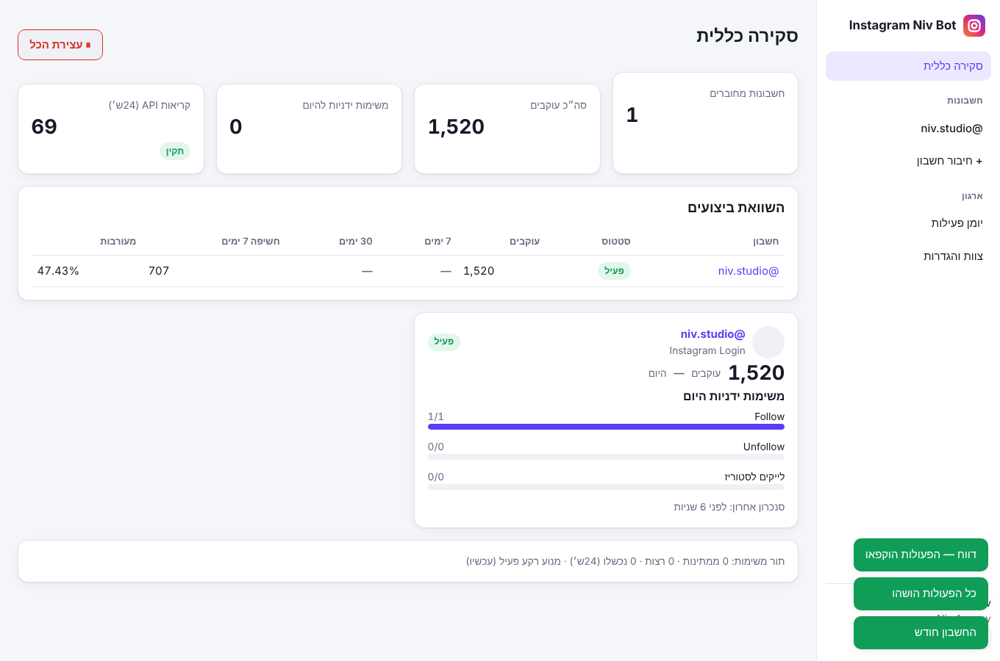
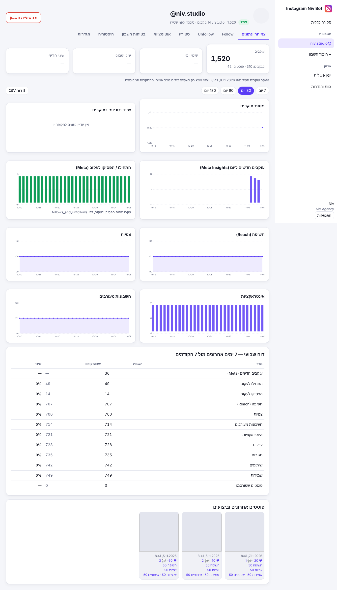
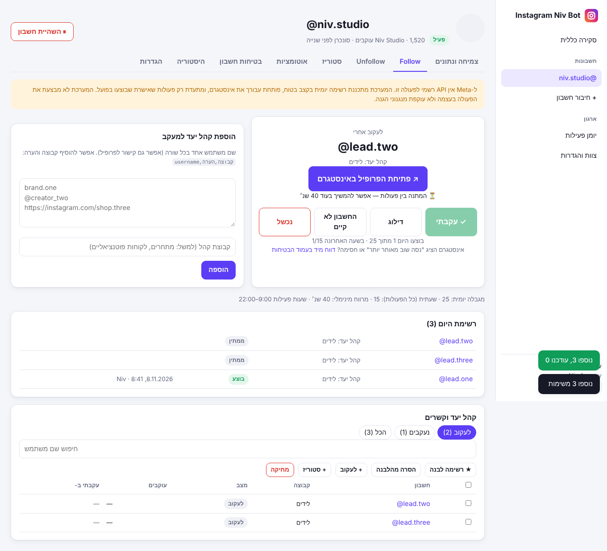
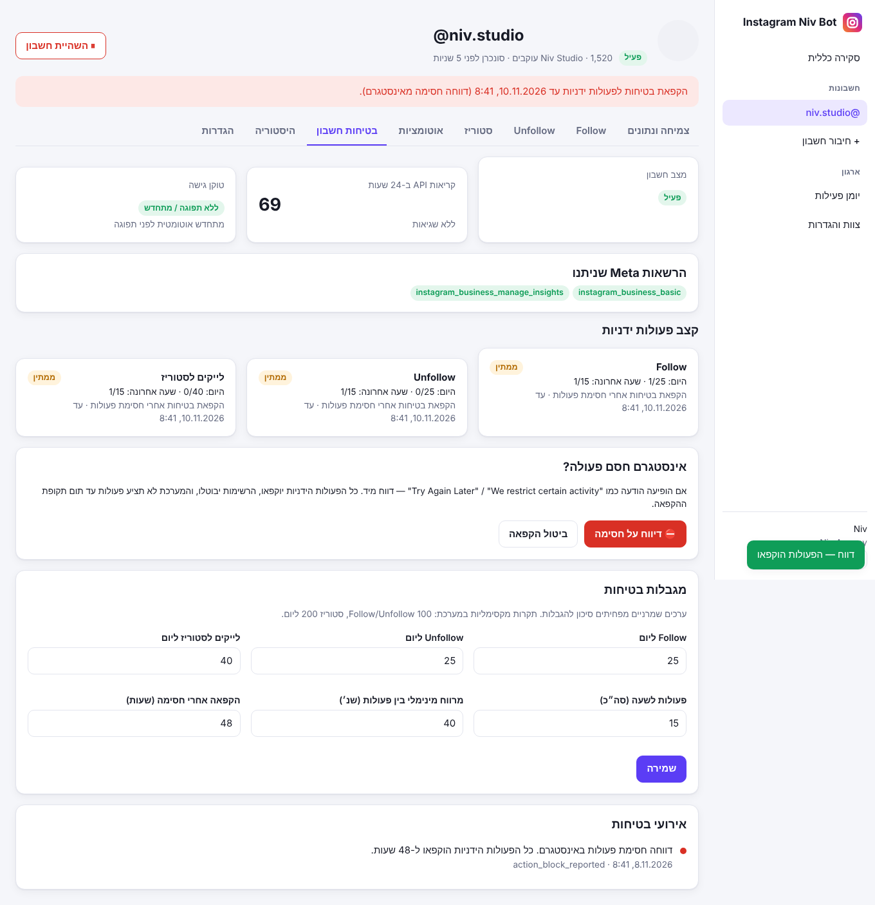

# Instagram Niv Bot

Instagram Niv Bot manages growth for several Instagram professional accounts. It works **only through the official Meta APIs**. Everything Meta supports runs automatically in the background. Follow, Unfollow and story likes have no official API, so they run as guided manual workflows with safety limits and a full record of every action. The system never bypasses Instagram's protections and never records an action as done unless someone confirmed doing it.

| | |
|---|---|
|  |  |
|  |  |

## Requirement status (checked against Meta's official documentation, October 2026)

| # | Requirement | Status | Details |
|---|---|---|---|
| 1 | Automatic Follow | ❌ **Not possible through an authorized API** | Meta has no follow endpoint, in any login type (IG User reference). The system doesn't automate it and never reports it as done. There's an optional tool for logging manual actions only. |
| 2 | Automatic Unfollow | ❌ **Not possible through an authorized API** | No unfollow endpoint and no followers list. "Doesn't follow back" is computed from Instagram's official data-download file, but the action itself is manual. |
| 3 | Likes on stories | ❌ **Not possible through an authorized API** | Meta's Likes API docs say explicitly: "Stories is not supported". |
| 3* | Likes on target audience's posts and Reels | ✅ **Real background engine** | Official Likes API (`POST /{ig-user-id}/likes`, `instagram_manage_engagement`, **Facebook Login only**). Posts are found through Business Discovery, likes are spaced within daily and hourly budgets, and a like counts only when Meta returns `success:true`. Requires App Review. |
| 4 | Growth analytics | ✅ Implemented | Follower snapshots, daily/weekly/monthly change, Insights (new followers, follows/unfollows, reach, views, engagement), charts, weekly report, CSV, account comparison, competitors (Facebook Login). |
| 5 | Meta Account Safety | ✅ Implemented | Classifies errors (token, permission, rate limit, policy block), reads usage headers, pauses before the limit, circuit breaker, stops jobs on an unhealthy account. |
| – | Scheduled publishing, auto-replies | Extras outside the original scope | Added on request. Not part of the requirement. |

Each account also has a **"✅ מה עובד" (what works)** screen that shows each capability's status from real runs (verified / failing / not run yet / not supported), not from assumptions.

### Verifying against the real Meta API
```bash
npm run verify:meta                                   # without credentials: endpoints, version, error format, classification
META_TEST_IG_TOKEN=... npm run verify:meta            # real account (Instagram Login): all syncs through the real worker
META_TEST_FB_TOKEN=... META_TEST_LIKE_MEDIA_ID=... npm run verify:meta   # Facebook Login + a real like
```
Behind an HTTP proxy, run with `NODE_USE_ENV_PROXY=1`.

## Autopilot: the account's main screen

Once an account is connected, everything runs automatically. Nothing has to be switched on, and every feature is a single switch:
- **Someone wrote "price"?** They get a public reply plus a private message right away. The wording is editable in one step.
- **Welcome message in DMs.** Works once Webhooks are configured.
- **Automatic likes for the target audience** (Facebook Login): paste usernames and it starts right away.
- **Growth data and account protection:** always on.
- **Follow / Unfollow / story likes:** shown on a clear "not supported by Meta" card.

All other screens are under "עוד" (more).

## Demo mode and work session

- **🎬 Demo account in one click:** "Open demo account" on the home screen or the connect page. It has 90 days of sample data, posts, competitors, an audience list and tasks. It's labeled "Demo" on every screen, never calls Meta, and is deleted from Settings like any other account.
- **▶ Work session:** all of today's manual tasks (Follow, story likes, Unfollow) in one flow with a progress bar. When it's not yet safe to continue, the system pauses and resumes automatically.
- **Bottom line:** a summary of the week in plain sentences at the top of the growth screen.
- **Demo video:** `npm run demo:video` records a walkthrough with Hebrew captions to `data/demo-video/niv-bot-demo.mp4`.

## Architecture

```
src/
  server.ts            Entry point: HTTP server plus the background engine (APP_ROLE=all|web|worker)
  app.ts               Fastify: security headers, error handling, routes, static UI
  config.ts            Environment variables with validation
  context.ts           Composition root (dependency injection)
  db/                  SQLite (WAL) with versioned migrations
  meta/                Graph client, error classification, OAuth (Instagram + Facebook Login), capability map
  services/            accounts · analytics · safety · targets · manual-tasks · relationship-import · audit
  queue/               Durable job queue (leases, backoff, dedupe, one job per account) plus worker and scheduler
  http/                Auth (sessions, roles, CSRF, rate limiting) and API routes
public/                Hebrew RTL web app with no build step (ES modules, built-in SVG charts)
test/                  31 unit and integration tests, plus a browser E2E test (Playwright)
```

- **Multi-tenant:** organizations, users and roles (owner, admin, member). Every query is scoped to the organization, and the tests check that one organization can't see another's data.
- **Security:** access tokens are encrypted with AES-256-GCM, passwords use scrypt, sessions are httpOnly cookies, there's a CSRF header, login is rate limited, and strict CSP headers are set. Tokens never reach the browser. `appsecret_proof` is sent on Facebook calls. The Deauthorize and Data Deletion callbacks Meta requires for App Review are implemented and signature-verified.
- **Reliability:** the job queue lives in the database and survives crashes (leases are recovered). Retries use exponential backoff with jitter. Throttled accounts are deferred without using up retry attempts. Shutdown is graceful, and there's a `/api/system/health` endpoint for monitoring.
- **Lean:** three runtime dependencies (`fastify`, `@fastify/static`, `pino`). The database is SQLite built into Node.

## Installation

Requires Node.js 22.18 or later.

```bash
npm install
cp .env.example .env        # fill in APP_ENCRYPTION_KEY (npm run keygen) and PUBLIC_BASE_URL
npm start                   # http://localhost:3000
```

Docker: `docker build -t niv-bot . && docker run -p 3000:3000 -v nivdata:/app/data --env-file .env niv-bot`

## Connecting to Meta: what you need to provide

1. Go to [developers.facebook.com](https://developers.facebook.com) and create an app of type **Business**.
2. **Instagram Login (recommended):** add the Instagram product, then open *API setup with Instagram login*.
   - Copy the **Instagram App ID / Secret** into `INSTAGRAM_APP_ID` and `INSTAGRAM_APP_SECRET`.
   - Add this OAuth Redirect URI: `{PUBLIC_BASE_URL}/api/oauth/instagram_login/callback`
   - Permissions: `instagram_business_basic`, `instagram_business_manage_insights`, `instagram_business_content_publish`, `instagram_business_manage_comments`, `instagram_business_manage_messages`
3. **Facebook Login (optional, adds competitor tracking):** add *Facebook Login for Business*.
   - Fill in `FACEBOOK_APP_ID` and `FACEBOOK_APP_SECRET`.
   - Redirect URI: `{PUBLIC_BASE_URL}/api/oauth/facebook_login/callback`
4. Callback URLs for App Review:
   - Deauthorize: `{PUBLIC_BASE_URL}/meta/deauthorize`
   - Data Deletion: `{PUBLIC_BASE_URL}/meta/data-deletion`
5. **Webhooks (for real-time auto-replies):** App Dashboard → Webhooks → Instagram.
   - Callback URL: `{PUBLIC_BASE_URL}/meta/webhook`
   - Verify token: the value of `META_WEBHOOK_VERIFY_TOKEN`
   - Fields: `comments`, `messages`
6. While the app is in development mode it only works for accounts with a role on the app (Instagram Tester). To offer the service to outside clients, you need **App Review** for Advanced Access.

**Quick start without OAuth:** generate an access token in the App Dashboard (*Generate token*) and paste it under "Connect with access token". The token is stored encrypted, and Instagram tokens are renewed automatically before they expire.

## Tests

```bash
npm run typecheck
npm test            # 31 tests: crypto, error classification, queue, safety, workflows, HTTP E2E, tenant isolation
npm run test:e2e    # real server process plus Chromium: sign-up → connect → analytics → Follow → import → automation → safety → mobile
```

The tests replace Meta with a test-only fake server (`test/fake-graph.ts`) that mimics the real response and error formats. The production server never uses fake data.

## Known limitations (Meta platform rules)

- There is no official API for Follow, Unfollow, story likes or the list of followers. These are handled as manual workflows plus the official data download.
- `follower_count` (new followers per day) is only available for accounts with 100+ followers, and only for the last 30 days.
- Business Discovery only returns data for business and creator accounts, and only with Facebook Login.
- Insights day boundaries follow Pacific time, as Meta reports them.
